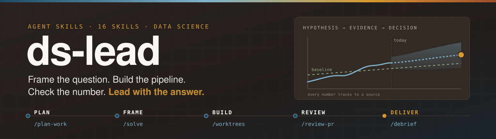
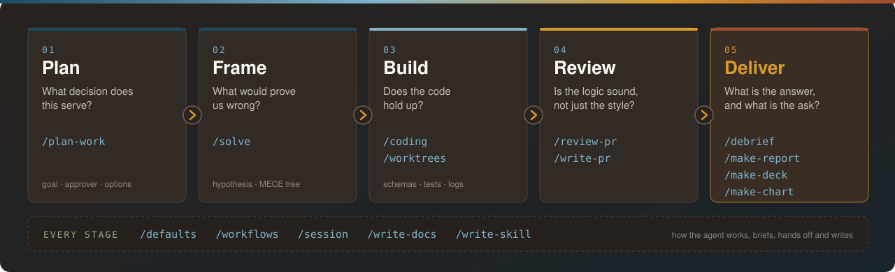

<p align="center">
  
</p>

<h1 align="center">ds-lead</h1>

<p align="center">
  <em>Frame the question. Build the pipeline. Check the number. Lead with the answer.</em>
</p>

<p align="center">
  
  
  
  
</p>

---

**Agent skills for data science work that ends in a decision.**

As a data science tech lead, these are the skills I hand my own team and agents: each one comes from a mistake I saw repeat in real work, follows a method that predates AI, and is small enough to read in five minutes.

Most agent skills are written for software features. Data science work fails in different places: an analysis answers a question nobody asked, a number in the deck cannot be traced, a pipeline has no tests, and the stakeholder reads three paragraphs before the answer. These seventeen skills make an agent work the way a senior data scientist does at each of those points. They are plain Markdown, so they work in Claude Code, Codex, Gemini CLI, Cursor, Grok, Antigravity and other agents that read Agent Skills. No MCP servers, no build step.

<p align="center">
  
</p>

## Commands

| What you're doing                   | Command           | Key principle                                 |
| :---------------------------------- | :---------------- | :-------------------------------------------- |
| Plan new work                       | `/plan-work`      | Decide before you ticket                      |
| Plan a workshop or training module  | `/plan-training`  | Backward design from learner outcomes         |
| Frame a question or find a cause    | `/solve`          | A hypothesis you can prove wrong              |
| Work on more than one branch        | `/worktrees`      | One folder per branch                         |
| Review a pull request               | `/review-pr`      | Soundness before style                        |
| Describe a pull request             | `/write-pr`       | A reviewer can test from it                   |
| Write a message someone acts on     | `/debrief`        | Answer first, then the evidence               |
| Write a one-page report             | `/make-report`    | The title is the finding                      |
| Build a slide deck                  | `/make-deck`      | Code fills every number                       |
| Make or restyle a chart             | `/make-chart`     | Colorblind-safe, one message                  |
| Write pipeline code or tests        | `/coding`         | Fail loud, test the logic                     |
| Write a doc or a changelog          | `/write-docs`     | Short, active, one term per concept           |
| Check a backtest number             | `/check-backtest` | Beat the noise floor first                    |
| Order the steps of a task           | `/workflows`      | The right skill at each step                  |
| Start, hand off or resume a session | `/session`        | State lives in a file                         |
| Set how the agent works             | `/defaults`       | Challenge, then act                           |
| Write or fix a skill                | `/write-skill`    | Fix a repeated mistake at its strongest level |

Six of these (`coding`, `write-docs`, `session`, `workflows`, `defaults` and `check-backtest`) also load on their own when the work matches, so you rarely type them.

In Claude Code, a plugin skill also answers to its full name, for example `/ds-lead:review-pr`. Use it when a built-in command has the same name.

## Install (30 seconds)

```bash
npx skills add kamingfung/ds-lead --skill '*' --global
```

The [skills CLI](https://skills.sh) installs every skill into your agents. Add `--agent claude-code` (or `codex`, `gemini-cli`, `antigravity`) to pick one, or drop `--global` to install into the current project only.

<details>
<summary><b>Antigravity, as a plugin</b></summary>

```bash
git clone https://github.com/kamingfung/ds-lead.git ~/repos/ds-lead
mkdir -p ~/.gemini/config/plugins
ln -sfn ~/repos/ds-lead ~/.gemini/config/plugins/ds-lead
```

The repository follows the [`agent-plugins`](plugin.json) 1.0.0 schema, so Antigravity loads `plugin.json` and every `skills/*/SKILL.md` as one plugin.

</details>

<details>
<summary><b>Any agent, by symlink from a clone</b></summary>

Link `skills/*` into your agent's skills folder, so `git pull` updates them in place:

| Agent       | Global skills folder            | Project skills folder |
| :---------- | :------------------------------ | :-------------------- |
| Antigravity | `~/.gemini/antigravity/skills/` | `.agents/skills/`     |
| Claude Code | `~/.claude/skills/`             | `.claude/skills/`     |
| Codex       | `~/.codex/skills/`              | `.agents/skills/`     |
| Gemini CLI  | `~/.gemini/skills/`             | `.gemini/skills/`     |
| Grok        | `~/.grok/skills/`               | `.grok/skills/`       |

```bash
# Example: Codex, global
mkdir -p ~/.codex/skills
for s in ~/repos/ds-lead/skills/*; do
  ln -sfn "$s" ~/.codex/skills/"$(basename "$s")"
done
```

</details>

<details>
<summary><b>Update and uninstall</b></summary>

```bash
git -C ~/repos/ds-lead pull     # symlinked installs update at once
npx skills update               # skills CLI installs

rm ~/.gemini/config/plugins/ds-lead   # Antigravity plugin
npx skills remove defaults workflows session coding write-docs plan-work plan-training write-pr review-pr check-backtest worktrees debrief make-report make-deck make-chart solve write-skill --global
```

</details>

## Why these skills exist

### 1. The analysis answers a question nobody asked

**The problem.** The agent opens a notebook and starts plotting. Two days later, the result is correct and useless, because nobody agreed what decision it serves.

**The fix.** [`/plan-work`](skills/plan-work/SKILL.md) names the goal and the approver before any ticket, lays out the alternatives with their cost and risk, and walks you through one decision at a time. [`/solve`](skills/solve/SKILL.md) then states a hypothesis you can prove wrong and builds a MECE issue tree to test it.

### 2. A number in the deck cannot be traced

**The problem.** A figure was typed by hand from an earlier run. Nobody can say which query produced it, and the next refresh silently disagrees.

**The fix.** [`/make-deck`](skills/make-deck/SKILL.md) builds HTML decks where code fills every number, chart and table, and each slide carries its source. [`/make-report`](skills/make-report/SKILL.md) puts an evidence table before the prose, and a check script flags any number without a source.

### 3. The pipeline works on the analyst's laptop only

**The problem.** Nodes read files, defaults hide failed fetches, and the tests check that a function runs, not that it is right.

**The fix.** [`/coding`](skills/coding/SKILL.md) holds one standard for pipeline code: pure functions, schema checks at the boundaries (Pandera, for example), strict parameter access, tests built from realistic fixtures, and log lines that name what failed. [`/review-pr`](skills/review-pr/SKILL.md) checks soundness before style, and [`/write-pr`](skills/write-pr/SKILL.md) writes a description a reviewer can test from.

### 4. The stakeholder reads three paragraphs before the answer

**The problem.** The agent reports what it did, in the order it did it. The decision-maker skims, misses the ask, and replies with a question.

**The fix.** [`/debrief`](skills/debrief/SKILL.md) writes the answer first, then two to four pieces of evidence with their numbers and sources, then one ask with an owner and a date. [`/make-chart`](skills/make-chart/SKILL.md) gives each chart one message on a colorblind-safe palette.

## Skills

Each rule lives in one skill; the others name it instead of repeating it.

**Plan, frame and deliver**

| Skill                                            | What it does                                                                                                                                                     | Key resources                                                                                                                                                                                                                                                                                                                                                                |
| :----------------------------------------------- | :--------------------------------------------------------------------------------------------------------------------------------------------------------------- | :--------------------------------------------------------------------------------------------------------------------------------------------------------------------------------------------------------------------------------------------------------------------------------------------------------------------------------------------------------------------------- |
| [`plan-work`](skills/plan-work/SKILL.md)         | A one-page plan before any ticket: goal and approver, alternatives, decisions, steps, risks and outcomes                                                         | [`plan.md`](skills/plan-work/references/plan.md), [`design-before-building.md`](skills/plan-work/references/design-before-building.md)                                                                                                                                                                                                                                       |
| [`plan-training`](skills/plan-training/SKILL.md) | Backward design for technical workshops and courses: Bloom's taxonomy outcomes, active learning, learner-centered syllabi, rubrics and feedback                  | [`backward-design-guide.md`](skills/plan-training/references/backward-design-guide.md), [`active-learning-catalog.md`](skills/plan-training/references/active-learning-catalog.md), [`learner-centered-syllabus.md`](skills/plan-training/references/learner-centered-syllabus.md), [`feedback-grading-guide.md`](skills/plan-training/references/feedback-grading-guide.md) |
| [`solve`](skills/solve/SKILL.md)                 | Hypothesis-first problem solving: a MECE `if/then` issue tree, a 70/30 quantitative drill-down by elimination, and a top-down recommendation                     | —                                                                                                                                                                                                                                                                                                                                                                            |
| [`debrief`](skills/debrief/SKILL.md)             | Executive summaries, status updates, decision asks, Q&A, and slide storylines, answer first                                                                      | [`summaries-and-qa.md`](skills/debrief/references/summaries-and-qa.md)                                                                                                                                                                                                                                                                                                       |
| [`make-report`](skills/make-report/SKILL.md)     | A one-page report someone acts on (experiment, incident, analysis finding), in gated steps with a report check                                                   | [`standard.md`](skills/make-report/references/standard.md), [`checklist.md`](skills/make-report/references/checklist.md)                                                                                                                                                                                                                                                     |
| [`make-deck`](skills/make-deck/SKILL.md)         | Self-contained `1280x720` HTML decks: title-only outline first, action titles, inline SVG charts, a source for every number, a three-pass review, `.pptx` export | [`template/`](skills/make-deck/template/)                                                                                                                                                                                                                                                                                                                                    |
| [`make-chart`](skills/make-chart/SKILL.md)       | matplotlib and seaborn styling on a colorblind-safe palette, with 15 chart recipes and the encoding rules                                                        | [`chart_style.py`](skills/make-chart/chart_style.py), [`visualization.md`](skills/make-chart/references/visualization.md)                                                                                                                                                                                                                                                    |
| [`write-docs`](skills/write-docs/SKILL.md)       | Docs, changelogs, PR text and chat replies: structure, terminology, short active sentences, figures, tables and equations                                        | —                                                                                                                                                                                                                                                                                                                                                                            |

**Build and review**

| Skill                                              | What it does                                                                                                                                             | Key resources                                                                                                                                                                       |
| :------------------------------------------------- | :------------------------------------------------------------------------------------------------------------------------------------------------------- | :---------------------------------------------------------------------------------------------------------------------------------------------------------------------------------- |
| [`coding`](skills/coding/SKILL.md)                 | Agree the goal first, build only what was asked, change only what the task needs; Python pipeline style, unit tests and logging                          | [`python-pipeline.md`](skills/coding/references/python-pipeline.md), [`unit-tests.md`](skills/coding/references/unit-tests.md), [`logging.md`](skills/coding/references/logging.md) |
| [`worktrees`](skills/worktrees/SKILL.md)           | One isolated folder per branch: create, use and clean up git worktrees                                                                                   | —                                                                                                                                                                                   |
| [`check-backtest`](skills/check-backtest/SKILL.md) | Questions to answer before you report a backtest or experiment number: the expected result, the noise floor, whether the change ran, same inputs, slices | —                                                                                                                                                                                   |
| [`review-pr`](skills/review-pr/SKILL.md)           | Gated PR review and answering a review: tier from the diff, pre-commit and CI first, referee review, a severity label per finding, a three-round cap     | [`standard.md`](skills/review-pr/references/standard.md), [`answering-a-review.md`](skills/review-pr/references/answering-a-review.md)                                              |
| [`write-pr`](skills/write-pr/SKILL.md)             | A PR body: summary, changes, why, results, how to test with runnable commands, and reviewer notes led by the merge risk                                  | —                                                                                                                                                                                   |

**How the agent works**

| Skill                                        | What it does                                                                                                                                                         | Key resources                                                                    |
| :------------------------------------------- | :------------------------------------------------------------------------------------------------------------------------------------------------------------------- | :------------------------------------------------------------------------------- |
| [`defaults`](skills/defaults/SKILL.md)       | Critical-thinking posture, answer-first replies, parallel sub-agents, self-contained briefs, batched remote writes, traceability                                     | [`delegation.md`](skills/defaults/references/delegation.md)                      |
| [`workflows`](skills/workflows/SKILL.md)     | Steps in order for a bug fix, an investigation, a ticket pickup, a feature or opening a PR, each naming the skill it needs; engineering practice from real incidents | [`engineering-practice.md`](skills/workflows/references/engineering-practice.md) |
| [`session`](skills/session/SKILL.md)         | Starting, handing off and resuming a session; progress in a changelog                                                                                                | —                                                                                |
| [`write-skill`](skills/write-skill/SKILL.md) | Writing and reviewing skills and rule files: size, structure, triggers, overlap, and fixing a repeated mistake at its strongest level                                | —                                                                                |

## See it work

[`examples/global-food-supply/`](examples/global-food-supply/) builds a full readout from three public Our World in Data CSVs: schema-checked inputs, a `1280x720` [deck](examples/global-food-supply/deck.html), an interactive [one-pager](examples/global-food-supply/report.html), and a `.pptx` export, every number filled by code.

## Customize colors and fonts

All colors and font stacks live in two `palette.css` files, so you can rebrand decks and charts without touching code.

- **Decks:** edit [`skills/make-deck/template/palette.css`](skills/make-deck/template/palette.css), or pass your own file with the same token names to `build(..., palette="my_palette.css")`. The `.pptx` exporter reads its theme colors from the deck's `:root` block.
- **Charts:** edit [`skills/make-chart/palette.css`](skills/make-chart/palette.css), or set `CHART_STYLE_PALETTE=/path/to/palette.css` before importing `chart_style.py`.
- **Shared tokens** (`--ink`, `--paper`, `--panel`, `--tint`, `--light`, `--blue`, `--red`, `--orange`, `--green`, `--sky`, `--purple`) must match in both files; [`test_palette.py`](skills/make-deck/template/test_palette.py) checks it.

## Releases

- [CHANGELOG.md](CHANGELOG.md) lists what changed, newest first. A release is a Semantic Versioning tag, `vMAJOR.MINOR.PATCH`, and `plugin.json` carries the same version without the `v`.
- Every pull request adds one line under "Unreleased". Steps and checks: [CONTRIBUTING.md](CONTRIBUTING.md).

## License and credits

MIT. See [`LICENSE`](LICENSE).

**Standing on others' work.** These skills are inspired by, and borrow ideas from, five open-source skill libraries. I rewrote everything in my own words for data science work, but the thinking is theirs as much as mine:

| Project                                                                   | What ds-lead borrows                                                                                                         |
| :------------------------------------------------------------------------ | :--------------------------------------------------------------------------------------------------------------------------- |
| [Matt Pocock's skills](https://github.com/mattpocock/skills)              | Grilling before you build, the writing-for-agents review pass in `write-skill`, problem-then-fix framing                     |
| [pstack](https://github.com/backnotprop/pstack)                           | Task playbooks in `workflows`, the benchmark checklist in `check-backtest`, the repeated-mistake ladder, verification labels |
| [Superpowers](https://github.com/obra/superpowers)                        | Design before building, verification before completion, receiving a code review                                              |
| [Agent Skills by Addy Osmani](https://github.com/addyosmani/agent-skills) | Lifecycle stages with one command each, red-flag and verification sections                                                   |
| [Ponytail](https://github.com/DietrichGebert/ponytail)                    | The smallest change that fully solves the task, the README header and badge style                                            |

Their licenses and notices are in [`THIRD_PARTY_NOTICES.md`](THIRD_PARTY_NOTICES.md). If you like ds-lead, go star them too.

`solve` follows the case-interview approach in V. Cheng, _Case Interview Secrets_ (Innovation Press, 2012), and M. P. Cosentino, _Case in Point_, 9th ed. (Burgee Press, 2016); the wording is our own.

Each skill lists its sources in `skills/<name>/SOURCES.md`: which idea, number or quote comes from which source, and the full reference. The skill files carry no citations, so they stay short for the agent.
